# Sega 32X

## Overview

The Sega 32X application is an emulator for the [Sega 32X](https://en.wikipedia.org/wiki/32X), an add-on for the Sega Genesis/Mega Drive that added a pair of SH-2 processors for enhanced graphics.

<figure>
  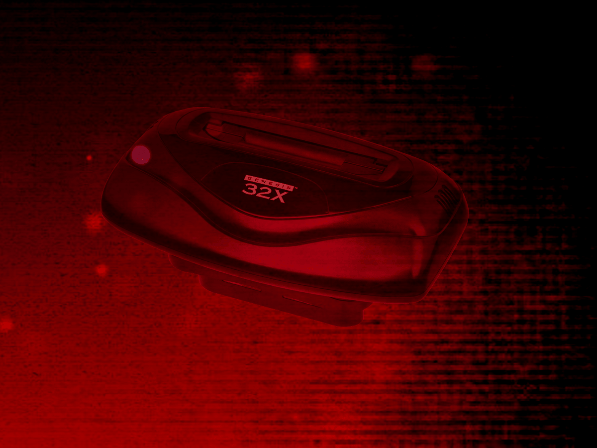
</figure>

## Controls

The emulator supports up to two controllers. The keyboard and gamepad mappings are listed in the tables below.

### Keyboard

Keyboard support is only available for controller one.

| __Name__ | <div style="min-width:140px">__Keys__</div> | __Comments__ |
|--------------------------|---------------------------------------------| |
| Move | 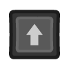{: class="control"} 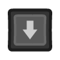{: class="control"} 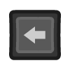{: class="control"} 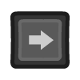{: class="control"}  | |
| A | {: class="control"} | |
| B | {: class="control"} | |
| C | 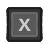{: class="control"} | |
| X | {: class="control"} | |
| Y | 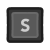{: class="control"} | |
| Z | {: class="control"} | |
| Start | {: class="control"} | |
| Mode | 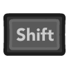{: class="control"} | The __Right Shift Key__.|
| Show Pause Screen | 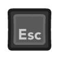{: class="control"} | |
| Show Pause Screen<br>(Alternate) | 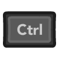{: class="control"} + {: class="control"} | Hold the __Control Key__ and press the __Shift Key__ to show the webЯcade pause screen. |

### Gamepad

Gamepad support is available for both controllers.

| __Name__ | <div style="min-width:140px">__Gamepad__</div> | __Comments__ |
| --- | --- | --- |
| Move                         | {: class="control"} &nbsp;or&nbsp; {: class="control"} | |
| A                       | {: class="control"} | |
| B                       | {: class="control"}  | |
| C                       | {: class="control"} | |
| X                       | 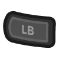{: class="control"}  | |
| Y           | {: class="control"} | |
| Z          | 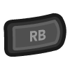{: class="control"}  | |
| Start                        | {: class="control"} | Not available for Xbox and not recommended for iOS (see alternate)<br><br>Press the __Menu (Start) Button__. |
| Start<br>(Alternate)            | {: class="control"} &nbsp;and&nbsp; 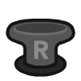{: class="control"} | Hold down the __Right Trigger__ and click (press down) on the __Right Thumbstick__. |
| Mode                       | {: class="control"}  | Not available for Xbox and not recommended for iOS (see alternate)<br><br>Press the __View (Back) Button__. |
| Mode<br>(Alternate)           | {: class="control"} &nbsp;and&nbsp; 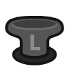{: class="control"} | Hold down the __Right Trigger__ and click (press down) on the __Left Thumbstick__. |
| Show Pause Screen                    | {: class="control"} &nbsp;and&nbsp; {: class="control"} | Not available for Xbox.<br><br>Hold down the __X Button__ and press the __View (Back) Button__. |
| Show Pause Screen<br>(Alternate)        | 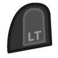{: class="control"} &nbsp;and&nbsp; {: class="control"} | Hold down the __Left Trigger__ and click (press down) on the __Left Thumbstick__. |

## On-screen Controls

<figure>
  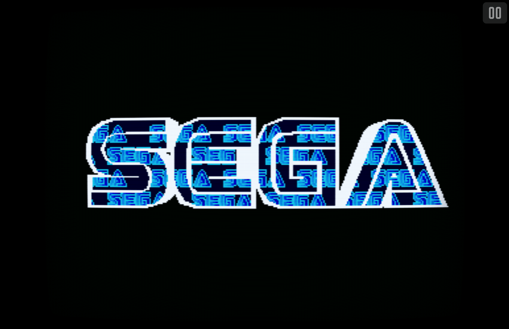
  <figcaption>On-screen Controls</figcaption>
</figure>

The 32X application includes an on-screen control which is detailed below.

| __Button__ |  | __Description__ |
| --- | --- | --- |
| Pause (Show Pause Screen) |  | Displays the webЯcade pause screen. |

Whether this button is always displayed, or only displayed once touch, mouse, or keyboard input is detected, can be configured via the "On-screen controls" field on the [Display Settings](#display-settings-tab) tab.

## Pause Screen

The Sega 32X application's pause screen provides access to application settings.

### Display Settings Tab

| __Field__ | __Description__ |
| --- | --- |
| Screen size | The screen size to use when playing a game.<br><br>Options include:<br><ul><li>`Native` : The application's native resolution</li><li>`16:9` : Widescreen resolution</li><li>`Fill` : Fill the entire contents of the screen</li></ul> |
| Bilinear filter | The type of bilinear filter to apply to the output display. |
| On-screen controls | Toggle whether the on-screen controls should always be displayed, or only displayed once touch, mouse, or keyboard input has been detected. |

## Battery-backed SRAM

Some 32X cartridges include battery-backed SRAM as a means of preserving state between sessions. The 32X application supports persisting this SRAM state into the browser's local storage or optionally to [cloud-based storage](../../../storage/index.md). The SRAM contents will be persisted whenever the pause screen is displayed (or the game is exited). Therefore, the menu should be displayed periodically for games that support battery-backed SRAM to ensure the state is properly persisted.

## Feed

This section details how Sega 32X application instances can be added to feeds.

### Type

The type name for the Sega 32X application is `retro-picodrive-32x`.

| __Type__ | __Cheats__ | __Shaders__ | __Retro<br>Achievements__ | __Low<br>CPU__ |
| --- | --- | --- | --- | --- |
| `retro-picodrive-32x` ⭐ | ✅ | ✅ | ✅ | x |

!!! note
    The alias `32x` also currently maps to this application. In the future, the `32x` alias may be mapped
    to another Sega 32X application (different emulator implementation) if it is determined to be a
    more appropriate default.

### Item Properties

The table below contains the properties that are specific to the Sega 32X application. These properties are specified in the `props` object of a feed item.

| __Property__ | __Type__ | __Required__ | __Details__ |
|----------|------|----------|---------|
| rom | URL | Yes | URL to a Sega 32X ROM file (`.32x`) or a zip file containing one. |
| cheat | URL | No | URL to a cheat file for the current ROM. See the [Cheats Tab](../../../editor/dialogs/item-dialog.md#cheats-tab) in the Item Editor for details on assigning cheat files. |
| pad3button | Boolean | No | Whether to use 3-button control pads (6-button is the default). |
| port2 | Numeric | No | The type of controller to emulate in port #2. Defaults to `0` (Gamepad).<br><ul><li>`0` : Gamepad</li><li>`1` : Light Gun</li><li>`10` : None</li></ul>Some games (e.g. Corpse Killer) require port #2 to be disconnected (`10`). |
| zoomLevel | Numeric | No | A numeric value indicating how much the display image should be zoomed in (0-40).<br><br>This property is typically used to hide the black borders that are present on some games. |

### Example

The following is an example of a complete feed that consists of a single Sega 32X application instance (`type` value of `32x`).

``` json hl_lines="9 11"
{
  "title": "Sega 32X",
  "categories": [
    {
      "title": "Sega 32X Games",
      "items": [
        {
          "title": "My 32X Game",
          "type": "32x",
          "props": {
            "rom": "https://<host>/mygame.32x"
          }
        }
      ]
    }
  ]
}
```

## References

- [Sega 32X Application GitHub Repository](https://github.com/webrcade/webrcade-app-retro-picodrive)
