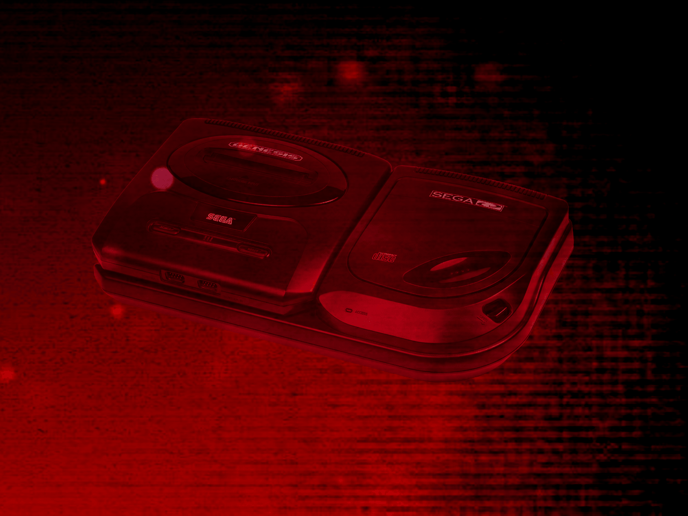
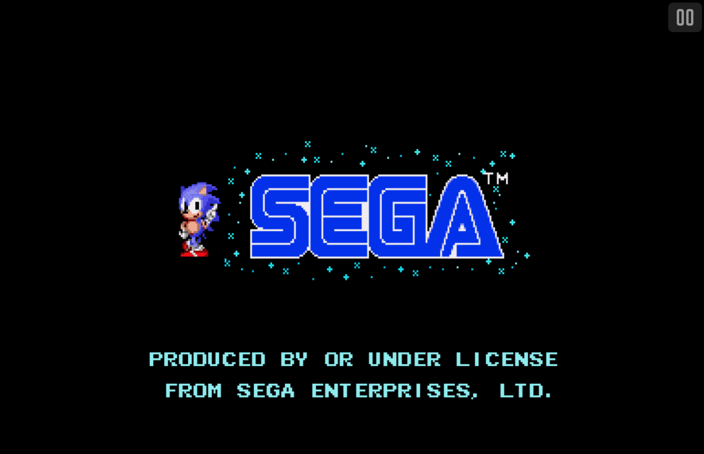

# Sega 32X CD

## Overview

The Sega 32X CD application is an emulator for Sega CD titles that require the [32X](https://en.wikipedia.org/wiki/32X) add-on, combining the Sega CD's CD-ROM drive with the 32X's enhanced graphics hardware.

<figure>
  
</figure>

## Adding Games (Feed Editor)

!!! important
    The Sega 32X CD application only supports the `.CHD` disc file format (`.ISO`, `.BIN`, and `.CUE` are not supported).

To add a Sega 32X CD game in the [Feed Editor](../../../editor/index.md): if your content is on your computer, see [Adding Items: Local Files](../../../editor/workspace/addingitems-local.md); if it's already hosted online, see [Adding Items: From URLs (Manual)](../../../editor/workspace/addingitems-url.md#manual-item-creation).

!!! important
    Both the iOS Safari and Xbox Series X|S Edge browsers limit the amount of memory that can be consumed by a particular web application (such as webЯcade).
    <p>
    The current limit is around 450 megabytes. Therefore, loading larger disc sizes may fail.
    </p>
    <p>
    To increase the likelihood of a game with a larger disc size loading, you can optionally choose to launch the game using a standalone-based link (versus launching the game within the webЯcade player or editor). See the [Standalone](../../../standalone/index.md) section of this documentation for further information (On Xbox, you would most likely want to bookmark the direct link. On iOS, you would most likely want to add the game to the home screen).
    </p>

## BIOS Files

The Sega 32X CD application requires the same set of Sega CD BIOS files as the [Sega CD](../segacd/index.md) application. See that page's [BIOS Files](../segacd/index.md#bios-files) section for the required files and their hashes.

## Controls

The Sega 32X CD application shares the exact same controller layout as the [Sega 32X](../32x/index.md) application. See that page's [Controls](../32x/index.md#controls) section for the full Keyboard and Gamepad mapping tables.

## On-screen Controls

<figure>
  
  <figcaption>On-screen Controls</figcaption>
</figure>

The Sega 32X CD application shares the exact same on-screen controls as the [Sega 32X](../32x/index.md) application. See that page's [On-screen Controls](../32x/index.md#on-screen-controls) section for details.

## Pause Screen

The Sega 32X CD application shares the exact same pause screen settings as the [Sega 32X](../32x/index.md) application. See that page's [Pause Screen](../32x/index.md#pause-screen) section for details.

## RAM Cart and Backup RAM Storage

The Sega 32X CD application supports preserving state from the Sega CD RAM Cart and Backup RAM between sessions. This state is persisted in the browser's local storage or optionally to [cloud-based storage](../../../storage/index.md). State information will be persisted whenever the pause screen is displayed (or the game is exited). Therefore, the pause screen should be displayed periodically to ensure the state is properly persisted.

## Feed

This section details how Sega 32X CD application instances can be added to feeds.

### Type

The type name for the Sega 32X CD application is `retro-picodrive-32xcd`.

| __Type__ | __Cheats__ | __Shaders__ | __Retro<br>Achievements__ | __Low<br>CPU__ |
| --- | --- | --- | --- | --- |
| `retro-picodrive-32xcd` ⭐ | x | ✅ | ✅ | x |

!!! note
    The alias `32xcd` also currently maps to this application. In the future, the `32xcd` alias may be mapped
    to another Sega 32X CD application (different emulator implementation) if it is determined to be a
    more appropriate default.

### Feed Properties

The table below contains global Sega 32X CD feed properties. These properties must be specified in the `props` object of the feed's [Feed Object](../../../feeds/format.md#feed-object).

| __Property__ | __Type__ | __Required__ | __Details__ |
|----------|------|----------|---------|
| segacd_bios | Array of URLs | Yes | An array of URLs to Sega CD BIOS files. See the [BIOS Files](#bios-files) section above. |

### Item Properties

The table below contains the properties that are specific to the Sega 32X CD application. These properties are specified in the `props` object of a feed item.

| __Property__ | __Type__ | __Required__ | __Details__ |
|----------|------|----------|---------|
| uid | String | Yes | <p>A unique identifier for the particular game (must be unique across all Sega 32X CD games).</p><p>This identifier is primarily used to associate persistent state with the game.</p>|
| discs | Array of URLs | Yes | <p>Array of URLs to one or more (for multi-disc games) Sega 32X CD game discs.</p><p>The Sega 32X CD application only supports the `.CHD` disc file format (`.ISO`, `.BIN`, and `.CUE` are not supported).</p> |
| pad3button | Boolean | No | Whether to use 3-button control pads (6-button is the default). |
| port2 | Numeric | No | The type of controller to emulate in port #2. Defaults to `0` (Gamepad).<br><ul><li>`0` : Gamepad</li><li>`1` : Light Gun</li><li>`10` : None</li></ul>Some games require port #2 to be disconnected (`10`). |
| zoomLevel | Numeric | No | A numeric value indicating how much the display image should be zoomed in (0-40).<br><br>This property is typically used to hide the black borders that are present on some games. |

### Example

The following is an example of a complete feed that consists of a single Sega 32X CD application instance (`type` value of `32xcd`).

It is also worth noting that the *Sega CD BIOS locations* (`segacd_bios`) are specified globally within the [Feed Object's](../../../feeds/format.md#feed-object) `props` object.

``` json hl_lines="4-8 16 18-21"
{
  "title": "Sega 32X CD",
  "props": {
    "segacd_bios": [
        "https://<host>/bios_CD_E.BIN",
        "https://<host>/bios_CD_J.BIN",
        "https://<host>/bios_CD_U.BIN"
    ]
  },
  "categories": [
    {
      "title": "Sega 32X CD Games",
      "items": [
        {
          "title": "My 32X CD Game",
          "type": "32xcd",
          "props": {
            "uid": "a1b2c3d4-e5f6-7890-abcd-ef1234567890",
            "discs": [
                "https://<host>/mygame.chd"
            ]
          }
        }
      ]
    }
  ]
}
```

## References

- [Sega 32X CD Application GitHub Repository](https://github.com/webrcade/webrcade-app-retro-picodrive)
