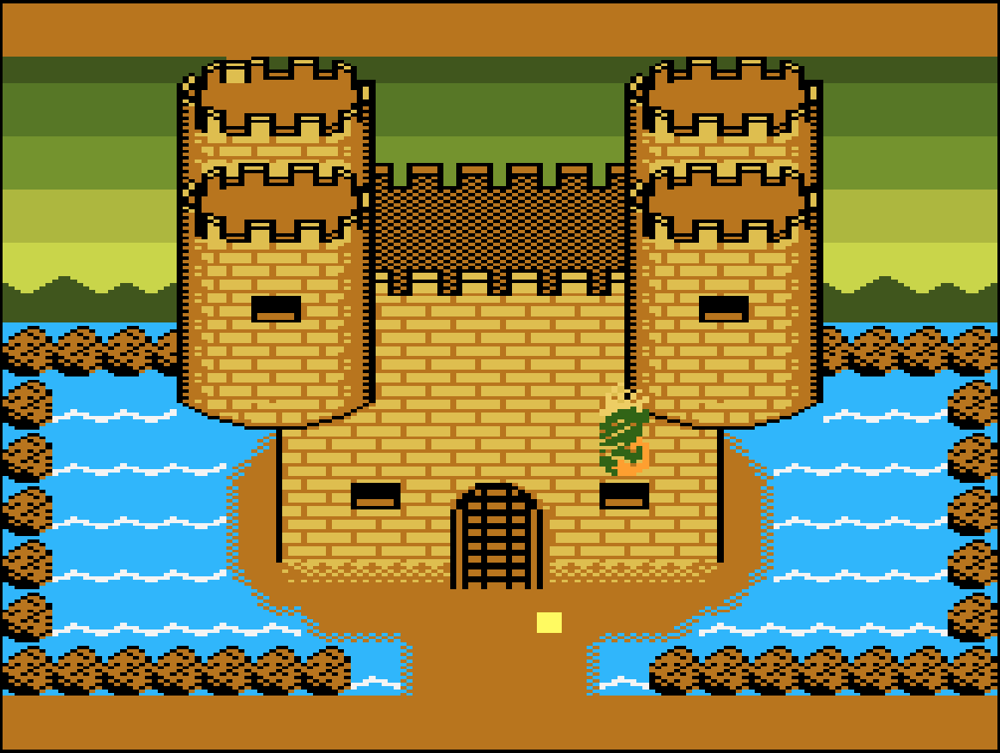
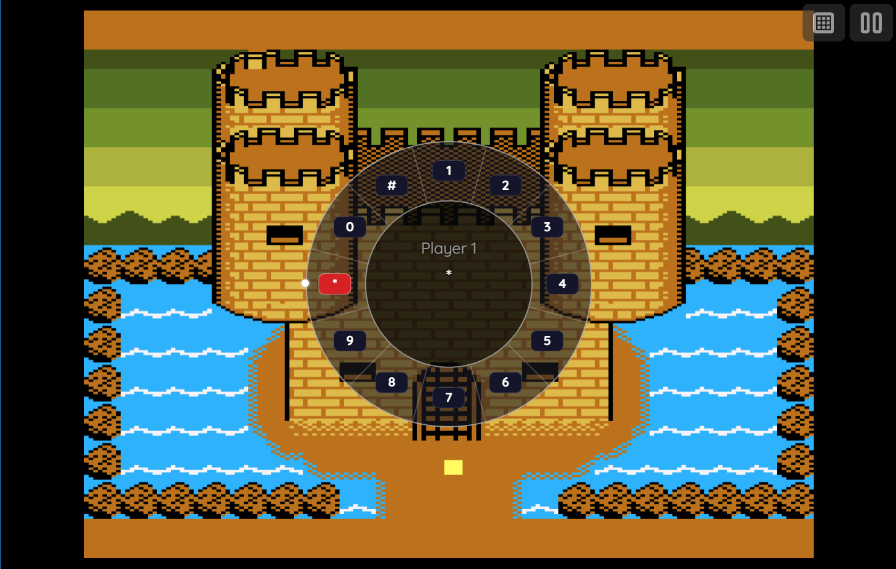
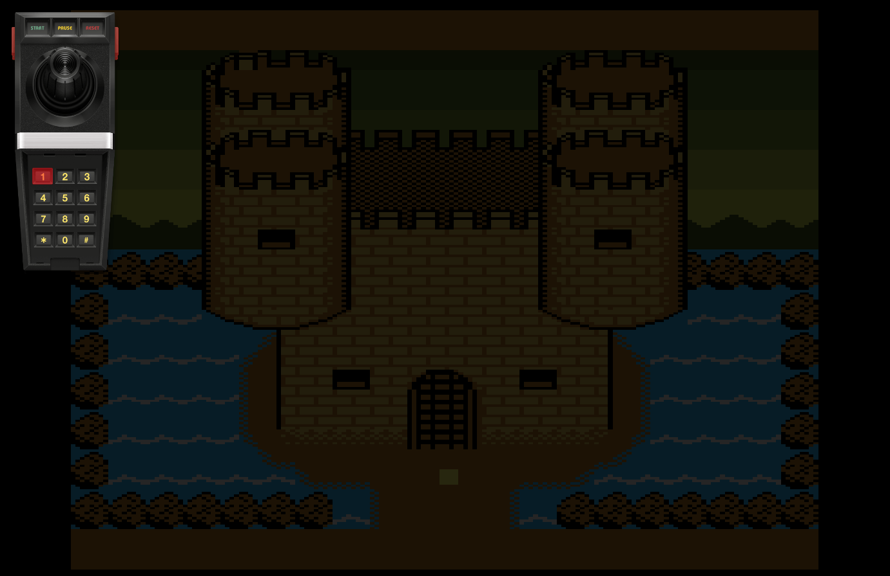
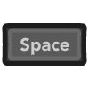
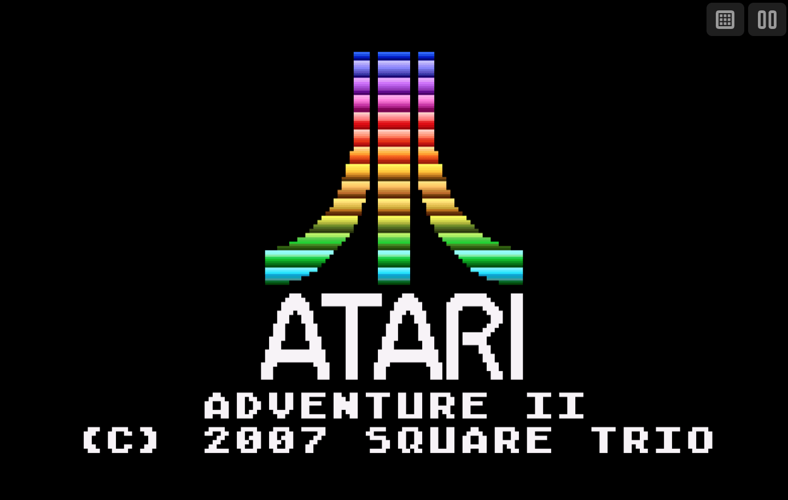

# Atari 5200

!!! note
    Single player only (core does not support second fire or keypad for player 2). Some newer homebrew titles are not supported (unsupported mappings in core). Analog quirks: holding the analog stick in a direction prior to a level starting can cause odd behavior in some games (Centipede, Missile Command, probably others).

## Overview

The Atari 5200 application is an emulator for the [Atari 5200](https://en.wikipedia.org/wiki/Atari_5200) game console.

<figure>
  
  <figcaption>Adventure II by The Square Trio Team</figcaption>
</figure>

## BIOS File (Optional)

In addition to Atari 5200 ROM files, an optional *Atari 5200 BIOS* (typically named `5200.rom`) can be specified globally within the feed (See the [Feed Properties Dialog](../../../editor/dialogs/feed-dialog.md#properties-tab) and [Atari 5200 Feed Properties](#feed-properties) sections).

| __File__ | __Hash (MD5)__ |
| --- | --- |
| `5200.rom` | 281f20ea4320404ec820fb7ec0693b38 |

## Controls

The emulator supports one controller. The keyboard and gamepad mappings are listed in the tables below.

### Standard Controls

#### Keyboard

Keyboard controls are listed below.

| __Name__ | <div style="min-width:140px">__Keys__</div> | __Comments__ |
|--------------------------|---------------------------------------------| |
| Move | {: class="control"} {: class="control"} {: class="control"} {: class="control"}  | |
| Bottom Fire | {: class="control"} | |
| Top Fire | {: class="control"} | |
| Start | {: class="control"} | |
| Show Keypad Display | {: class="control"} | The __Right Shift Key__. See [Keypad](#keypad) section for more details. |
| Show Keypad Display<br>(Alternate) | {: class="control"} | Hold, then release, to open the on-screen [Keypad](#keypad) screen. |
| Show Pause Screen | {: class="control"} | |

#### Gamepad

Gamepad mappings are listed below.

| __Name__ | <div style="min-width:140px">__Gamepad__</div> | __Comments__ |
| --- | --- | --- |
| Move                         | {: class="control"} | |
| Move                         | {: class="control"} | Analog input when `analog mode` is enabled. |
| Move (Player 2)              | {: class="control"} | When `twin stick` mode is enabled. |
| Bottom Fire                       | {: class="control"} | |
| Top Fire                       | {: class="control"} | |
| Start                        | {: class="control"} | Not available for Xbox and not recommended for iOS (see alternate)<br><br>Press the __Menu (Start) Button__. |
| Start<br>(Alternate)            | {: class="control"} &nbsp;and&nbsp; {: class="control"} | Hold down the __Right Trigger__ and click (press down) on the __Right Thumbstick__. |
| Toggle Keypad Display                        | {: class="control"} | Not available for Xbox and not recommended for iOS (see alternate)<br><br>Press the __View (Back) Button__.<br><br>See [Keypad](#keypad) section for more details. |
| Toggle Keypad Display <br>(Alternate)            | {: class="control"} &nbsp;and&nbsp; {: class="control"} | Hold down the __Left Trigger__ and click (press down) on the __Right Thumbstick__. |
| Show Pause Screen                    | {: class="control"} &nbsp;and&nbsp; {: class="control"} | Not available for Xbox.<br><br>Hold down the __X Button__ and press the __View (Back) Button__. |
| Show Pause Screen<br>(Alternate)        | {: class="control"} &nbsp;and&nbsp; {: class="control"} | Hold down the __Left Trigger__ and click (press down) on the __Left Thumbstick__. |

## Keypad

The following section describes how to interact with the Atari 5200 controller's keypad buttons. webЯcade provides two different ways to interact with it (the Radial Keypad is not available while `twinStick` mode is active):

### Radial Keypad (quick-select)

<figure>
  
  <figcaption>Radial Keypad</figcaption>
</figure>

Moving the right analog stick in a direction brings up a 12-key radial (pie-menu) selector, arranged clockwise from 12 o'clock: `1, 2, 3` (top), `4, 5, 6` (right), `7, 8, 9` (bottom), `*, 0, #` (left). Point the stick toward a key and confirm with either the Left or Right Bumper to press it. Releasing the stick back to center dismisses the selector without pressing anything.

| __Name__ | <div style="min-width:140px">__Gamepad__</div> | __Comments__ |
| --- | --- | --- |
| Show Radial Keypad / Choose Key | {: class="control"} | Suppressed while the Left Trigger is held down (to avoid conflicting with the grid keypad combo below), and while `twinStick` mode is active. |
| Press Key | {: class="control"} &nbsp;or&nbsp; {: class="control"} | |

<figure>
  
  <figcaption>On-screen Keypad Display</figcaption>
</figure>

### Gamepad (Virtual keypad)

| __Name__ | <div style="min-width:140px">__Gamepad__</div> | __Comments__ |
| --- | --- | --- |
| Show Keypad                        | {: class="control"} | Not available for Xbox and not recommended for iOS (see alternate)<br><br>Press the __View (Back) Button__. |
| Show Keypad<br>(Alternate)            | {: class="control"} &nbsp;and&nbsp; {: class="control"} | Hold down the __Left Trigger__ and click (press down) on the __Right Thumbstick__. |
| Close Keypad | {: class="control"} | |
| Choose Key |{: class="control"} &nbsp;or&nbsp; {: class="control"}   |  |
| Press Key  | {: class="control"} | The key button will continue to be pressed until the button is released. This is important as some games require long presses for the key to be recognized. |

### Keyboard (Virtual keypad)

| __Name__ | <div style="min-width:140px">__Keys__</div> | __Comments__ |
|--------------------------|---------------------------------------------| |
| Show Keypad | {: class="control"} | The __Right Shift Key__. |
| Show Keypad<br>(Alternate) | {: class="control"} | |
| Close Keypad | {: class="control"} | |
| Close Keypad<br>(Alternate) | {: class="control"} | |
| Close Keypad<br>(Alternate 2) | {: class="control"} | |
| Choose Key | {: class="control"} {: class="control"} {: class="control"} {: class="control"}  | |
| Press Key | {: class="control"} &nbsp;or&nbsp; {: class="control"} | |

### Keyboard (Direct mappings)

The key button will continue to be pressed until the keyboard key is released. This is important as some games require long presses for the key to be recognized.

| __Name__ | <div style="min-width:140px">__Keys__</div> | __Comments__ |
|--------------------------|---------------------------------------------| |
| Press key (0-9) | {: class="control"} - {: class="control"}  |  |
| Press key (Asterisk) | {: class="control"} |  |
| Press key (Pound) | {: class="control"}  |  |

## On-screen Controls

<figure>
  
  <figcaption>On-screen Controls</figcaption>
</figure>

The Atari 5200 application includes a set of on-screen controls which are detailed below.

| __Button__ |  | __Description__ |
| --- | --- | --- |
| Keypad |  | Opens the on-screen [Keypad](#keypad) screen. |
| Pause (Show Pause Screen) |  | Displays the webЯcade pause screen. |

Whether these buttons are always displayed, or only displayed once touch, mouse, or keyboard input is detected, can be configured via the "On-screen controls" field on the [Display Settings](#display-settings-tab) tab.

## Pause Screen

The Atari 5200 application's pause screen provides access to application settings.

### Display Settings Tab

| __Field__ | __Description__ |
| --- | --- |
| Screen size | The screen size to use when playing a game.<br><br>Options include:<br><ul><li>`Native` : The application's native resolution</li><li>`16:9` : Widescreen resolution</li><li>`Fill` : Fill the entire contents of the screen</li></ul> |
| Bilinear filter | The type of bilinear filter to apply to the output display. |
| On-screen controls | Toggle whether the on-screen controls should always be displayed, or only displayed once touch, mouse, or keyboard input has been detected. |

## Feed

This section details how Atari 5200 application instances can be added to feeds.

### Type

The type name for the Atari 5200 application is `retro-5200`.

| __Type__ | __Cheats__ | __Shaders__ | __Retro<br>Achievements__ | __Low<br>CPU__ |
| --- | --- | --- | --- | --- |
| `retro-5200` ⭐ | ✅ | ✅ | x | x |

!!! note
    The alias `5200` also currently maps to this application. In the future, the `5200` alias may be mapped
    to another Atari 5200 application (different emulator implementation) if it is determined to be a
    more appropriate default.

### Feed Properties

The table below contains global Atari 5200 feed properties. These properties must be specified in the `props` object of the feed's [Feed Object](../../../feeds/format.md#feed-object).

| __Property__ | __Type__ | __Required__ | __Details__ |
|----------|------|----------|---------|
| atari5200_rom | URL | No | (optional) URL to an Atari 5200 BIOS file or a zip file containing the BIOS file. |

### Item Properties

The table below contains the properties that are specific to the Atari 5200 application. These properties are
specified in the `props` object of a feed item.

| __Property__ | __Type__ | __Required__ | __Details__ |
|----------|------|----------|---------|
| rom | URL | Yes | URL to an Atari 5200 ROM file or a zip file containing a ROM file. |
| cheat | URL | No | URL to a cheat file for the current ROM. See the [Cheats Tab](../../../editor/dialogs/item-dialog.md#cheats-tab) in the Item Editor for details on assigning cheat files. |
| swap | Boolean | No | Whether to swap the controller ports. This is typically enabled when games default to using port 2 (versus port 1). |
| analog | Boolean | No | Whether to enable analog mode on the controllers. |
| twinStick | Boolean | No | Whether to enable twin stick style controls (player 1 uses player 2's joystick for firing). |
| mappings | Map of Strings (key-value pairs) | No | Game-specific mappings from the Atari 5200 keys and buttons to the gamepad.<br><br>The `key` in the map must be one of the following:<br><ul><li>`a`: A button</li><li>`b`: B button</li><li>`x`: X button</li><li>`y`: Y button</li><li>`lb`: Left bumper</li><li>`rb`: Right bumper</li><li>`lt`: Left trigger</li><li>`rt`: Right trigger</li></ul>The `value` in the map must be one of the following:<br><ul><li>Keypad button: `0`-`9`, `#`, `*`, `start`, `reset`, `pause`</li><li>Controller button: `topfire` (Top Fire), `bottomfire` (Bottom Fire)</li></ul>  |
| descriptions | Map of Strings (key-value pairs) | No | Provides game-specific descriptions for the Atari 5200 controller keys and buttons. Shown when the keypad or game-specific controls are displayed.<br><br>The `key` in the map must be one of the following:<br><ul><li>Keypad button: `0`-`9`, `#`, `*`, `start`, `reset`, `pause`</li><li>Controller button: `topfire` (Top Fire), `bottomfire` (Bottom Fire)</li></ul>The `value` in the map will be the description for the `key` (keypad or controller button).  |
| zoomLevel | Numeric | No | A numeric value indicating how much the display image should be zoomed in (0-40).<br><br>This property is typically used to hide the black borders that are present on some Atari 5200 games. |

### Example

The following is an example of a complete feed that consists of a single Atari 5200 application instance (`type` value of `5200`). The `rom` property value is a URL that points to a Dropbox location that contains the excellent homebrew game Adventure II by The Square Trio Team.

It is also worth noting that the *Atari 5200 BIOS location* (`atari5200_rom`) is specified globally within the [Feed Object's](../../../feeds/format.md#feed-object) `props` object.

``` json hl_lines="4 12 14"
{
  "title": "Atari 5200",
  "props": {
    "atari5200_rom": "https://<host>/5200.rom"
  },
  "categories": [
    {
      "title": "Atari 5200 Games",
      "items": [
        {
          "title": "Adventure II",
          "type": "5200",
          "props": {
            "rom": "https://www.dropbox.com/s/ks2wbcizcoe9fqw/adv2a.bin?dl=0"
          }
        }
      ]
    }
  ]
}
```

## References

- [Atari 5200 Application GitHub Repository](https://github.com/webrcade/webrcade-app-retro-a5200)
