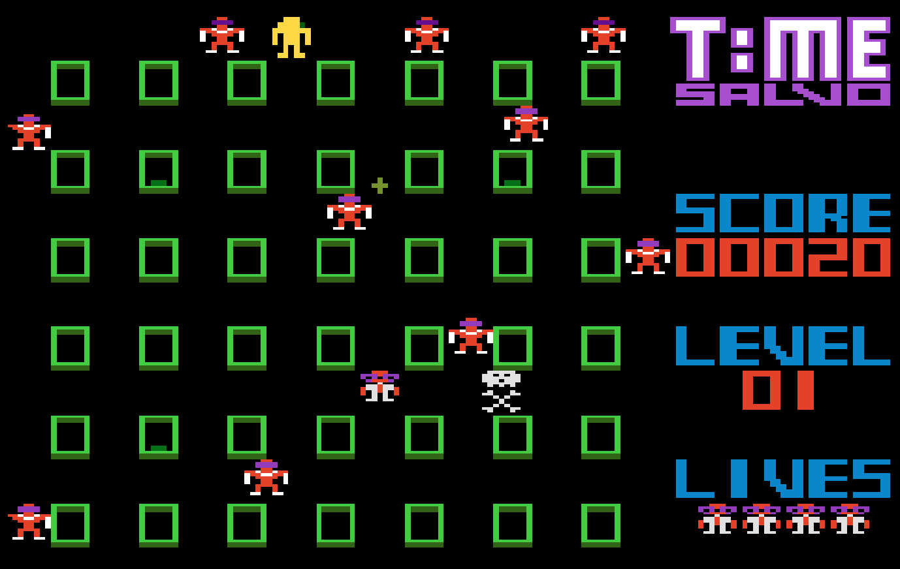
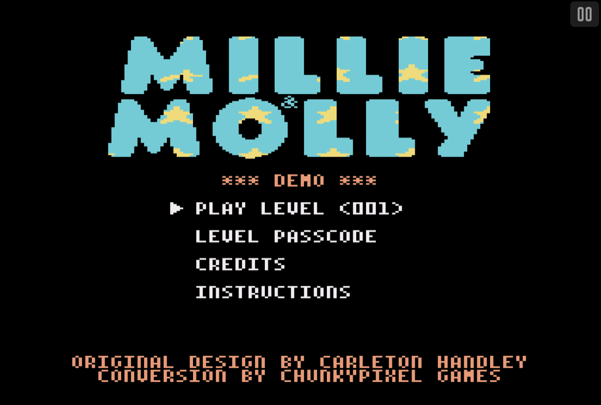
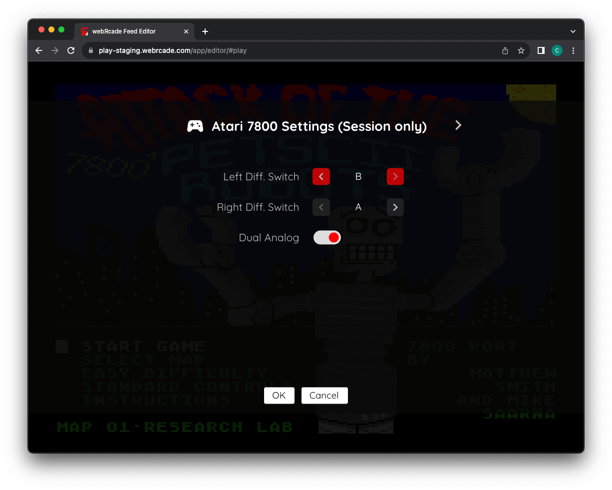

# Atari 7800

## Overview

The Atari 7800 application is an emulator for the [Atari 7800 ProSystem game console](https://en.wikipedia.org/wiki/Atari_7800).

<figure>
  
  <figcaption>Knight Guy in Low Res World: Castle Days by Vladimir Zuniga</figcaption>
</figure>

## Controls

The emulator supports up to two controllers. The keyboard and gamepad mappings are listed in the tables below.

### Keyboard

Keyboard support is only available for controller one.

| __Name__ | __Keys__ | __Comments__ |
|--------------------------|---------------------------------------------| |
| Move | {: class="control"} {: class="control"} {: class="control"} {: class="control"}  | |
| Fire 1 | {: class="control"} | |
| Fire 2 | {: class="control"} | |
| Pause | {: class="control"} | |
| Reset | {: class="control"} | |
| Select | {: class="control"} | The __Right Shift Key__.|
| Show Pause Screen | {: class="control"} | |
| Show Pause Screen<br>(Alternate) | {: class="control"} + {: class="control"} | Hold the __Control Key__ and press the __Shift Key__ to show the webЯcade pause screen. |

### Gamepad

Gamepad support is available for both controllers.

| __Name__ | <div style="min-width:140px">__Gamepad__</div> | __Comments__ |
| --- | --- | --- |
| Move                         | {: class="control"} &nbsp;or&nbsp; {: class="control"} | |
| Dual analog (if applicable)  | {: class="control"} | Player one's right analog stick can be used to produce input for player two's joystick (d-pad) for games that support a 2-stick mode (For example, the homebrew game TiME Salvo).  |
| Fire 1                       | {: class="control"} | |
| Fire 2                       | {: class="control"} | |
| Pause                       | {: class="control"} | |
| Reset                        | {: class="control"} | Not available for Xbox and not recommended for iOS (see alternate)<br><br>Press the __Menu (Start) Button__. |
| Reset<br>(Alternate)            | {: class="control"} &nbsp;and&nbsp; {: class="control"} | Hold down the __Right Trigger__ and click (press down) on the __Right Thumbstick__. |
| Select                       | {: class="control"}  | Not available for Xbox and not recommended for iOS (see alternate)<br><br>Press the __View (Back) Button__. |
| Select<br>(Alternate)           | {: class="control"} &nbsp;and&nbsp; {: class="control"} | Hold down the __Right Trigger__ and click (press down) on the __Left Thumbstick__. |
| Show Pause Screen                    | {: class="control"} &nbsp;and&nbsp; {: class="control"} | Not available for Xbox.<br><br>Hold down the __X Button__ and press the __View (Back) Button__. |
| Show Pause Screen<br>(Alternate)        | {: class="control"} &nbsp;and&nbsp; {: class="control"} | Hold down the __Left Trigger__ and click (press down) on the __Left Thumbstick__. |

## On-screen Controls

<figure>
  
  <figcaption>On-screen Controls</figcaption>
</figure>

The Atari 7800 application includes an on-screen control which is detailed below.

| __Button__ |  | __Description__ |
| --- | --- | --- |
| Pause (Show Pause Screen) |  | Displays the webЯcade pause screen. |

Whether this button is always displayed, or only displayed once touch, mouse, or keyboard input is detected, can be configured via the "On-screen controls" field on the [Display Settings](#display-settings-tab) tab.

## Pause Screen

The Atari 7800 application's pause screen provides access to application settings.

{: class="center zoomD"}

### Atari 7800 Settings Tab (Session Only)

The settings on this tab are *Session only*, meaning they will not persist between gaming sessions.

| __Field__ | __Description__ |
| --- | --- |
| Left Difficulty Switch | Toggles between the `A` and `B` left difficulty switch options (is a physical switch on the 7800 console). |
| Right Difficulty Switch | Toggles between the `A` and `B` right difficulty switch options (is a physical switch on the 7800 console). |
| Dual Analog | Whether to enable twin stick style controls (player 1 uses player 2's joystick for firing, etc.). |

### Display Settings Tab

| __Field__ | __Description__ |
| --- | --- |
| Screen size | The screen size to use when playing a game.<br><br>Options include:<br><ul><li>`Native` : The application's native resolution</li><li>`16:9` : Widescreen resolution</li><li>`Fill` : Fill the entire contents of the screen</li></ul> |
| Bilinear filter | The type of bilinear filter to apply to the output display. |
| On-screen controls | Toggle whether the on-screen controls should always be displayed, or only displayed once touch, mouse, or keyboard input has been detected. |

## Feed

This section details how Atari 7800 application instances can be added to feeds.

### Types

Two Atari 7800 application types are available, each offering different trade-offs in compatibility, features, and system resource requirements. The type below marked with a ⭐ is the default, and is mapped to the `7800` alias. The default can be overridden globally in [Settings](../../../userguide/settings.md) > *Applications*, or on a per-item basis in the [Feed Editor](../../../editor/index.md).

| __Type__ | __Cheats__ | __Shaders__ | __Retro<br>Achievements__ | __Low<br>CPU__ |
| --- | --- | --- | --- | --- |
| `retro-prosystem` ⭐ | ✅ | ✅ | ✅ | x |
| `js7800` | x | x | x | ✅ |

### Properties

The table below contains the properties that are specific to the Atari 7800 application. These properties are
specified in the `props` object of a feed item.

| __Property__ | __Type__ | __Required__ | __Details__ |
|----------|------|----------|---------|
| rom | URL | Yes | URL to an Atari 7800 ROM file or a zip file containing a ROM file. |
| cheat | URL | No | URL to a cheat file for the current ROM. See the [Cheats Tab](../../../editor/dialogs/item-dialog.md#cheats-tab) in the Item Editor for details on assigning cheat files.<br><br>*(`retro-prosystem` type only)* |
| zoomLevel | Numeric | No | A numeric value indicating how much the display image should be zoomed in (0-40).<br><br>This property is typically used to hide the black borders that are present on some games. |

### Example

The following is an example of a complete feed that consists of a single Atari 7800 application instance (`type` value of `7800`). The `rom` property value is a URL that points to a Dropbox location that contains the excellent homebrew game TiME Salvo by Mike Saarna.

``` json hl_lines="11 13"
{
  "title": "7800 Feed",
  "longTitle": "Atari 7800 Example Feed",
  "categories": [
    {
      "title": "7800 Games",
      "longTitle": "Atari 7800 Games",
      "items": [
        {
          "title": "TiME Salvo",
          "type": "7800",
          "props": {
            "rom": "https://dl.dropboxusercontent.com/s/q57y608mjqhoshr/salvo.a78"
          }
        }
      ]
    }
  ]
}
```


## References

- [Atari 7800 Application GitHub Repository (`retro-prosystem`)](https://github.com/webrcade/webrcade-app-retro-prosystem)
- [Atari 7800 Application GitHub Repository (`js7800`)](https://github.com/webrcade/webrcade-app-js7800)
