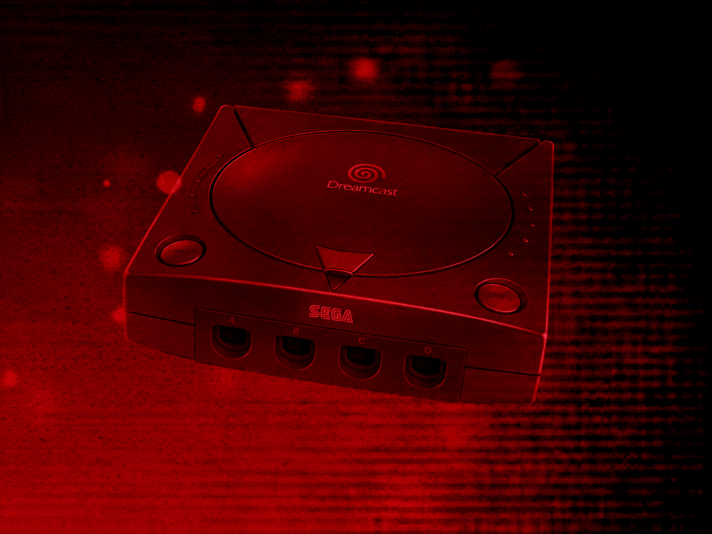
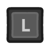
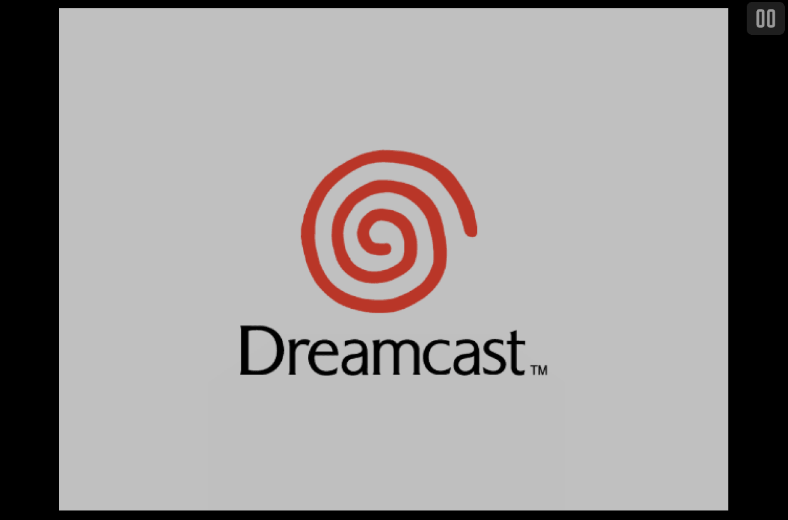
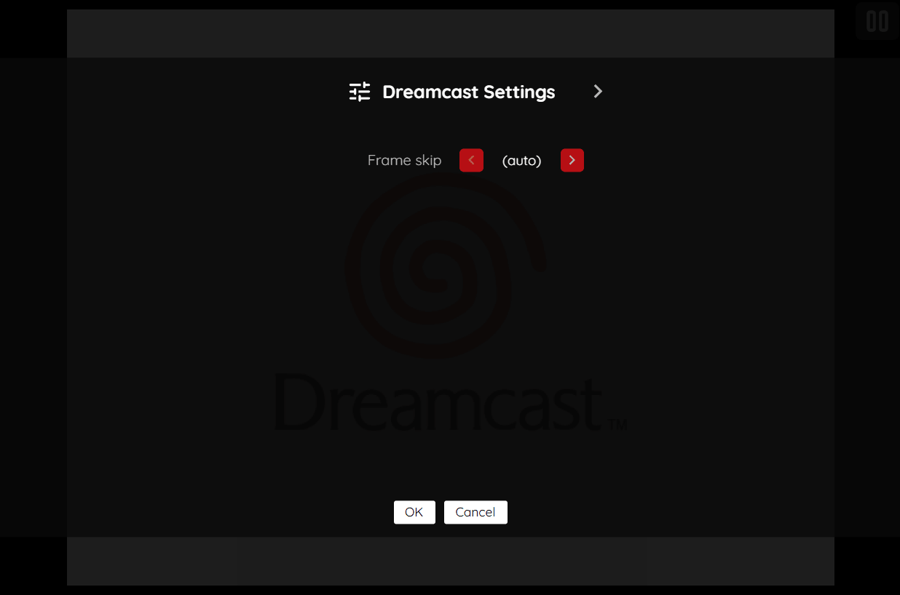

# Sega Dreamcast (Experimental)

!!! warning
    The Sega Dreamcast application is currently designated as an *experimental* application.
    <p>
    This designation has been applied due to the following:
    </p>
    <ul>
    <li>This is an early-stage emulator based on a from-scratch WebAssembly JIT recompiler.</li>
    <li>The resource requirements to properly run the emulator are high.</li>
    <li>Windows CE-based games are not currently supported.</li>
    </ul>
    <p>
    Applications marked as *experimental* are flagged with an "Experimental" tag in the feed editor's [Select Application Dialog](../../../editor/dialogs/item-dialog.md#select-application-dialog), but are otherwise fully available for use in both the editor and the webЯcade player. There is no separate setting required to enable them.
    </p>

## Overview

The Sega Dreamcast application is an emulator for the [Sega Dreamcast game console](https://en.wikipedia.org/wiki/Dreamcast).

Windows CE-based games are not currently supported.

<figure>
  
</figure>

Due to its high resource requirements (see *warning* at top of this page), the following devices are minimally recommended for running this application:

* Modern PC or Mac
* iPhone 16 (or newer)

## Adding Games (Feed Editor)

!!! important
    The Dreamcast application supports the `.CHD` and `.CDI` disc image formats.

To add a Dreamcast game in the [Feed Editor](../../../editor/index.md): if your content is on your computer, see [Adding Items: Local Files](../../../editor/workspace/addingitems-local.md); if it's already hosted online, see [Adding Items: From URLs (Manual)](../../../editor/workspace/addingitems-url.md#manual-item-creation).

!!! important
    Both the iOS Safari and Xbox Series X|S Edge browsers limit the amount of memory that can be consumed by a particular web application (such as webЯcade).
    <p>
    The current limit is around 450 megabytes. Therefore, loading larger disc sizes may fail.
    </p>
    <p>
    To increase the likelihood of a game with a larger disc size loading, you can optionally choose to launch the game using a standalone-based link (versus launching the game within the webЯcade player or editor). See the [Standalone](../../../standalone/index.md) section of this documentation for further information (On Xbox, you would most likely want to bookmark the direct link. On iOS, you would most likely want to add the game to the home screen).
    </p>

## BIOS Files

In addition to Sega Dreamcast Disc images, a set of *Dreamcast BIOS files* must be specified globally within the feed (See the [Feed Properties Dialog](../../../editor/dialogs/feed-dialog.md#properties-tab) and [Sega Dreamcast Feed Properties](#feed-properties) sections).

Both files below are required:

| <div style="min-width:120px">__File__</div> | __Hash (MD5)__ | __Description__ |
| --- | --- | --- |
| `dc_boot.bin` | e10c53c2f8b90bab96ead2d368858623 | Standard USA/PAL Dreamcast BIOS (HKT-0120 v1.01d) |
| `dc_flash.bin` | 9338b10ee6f13fbc8bfcd6276e156fad | Standard USA/PAL Dreamcast flash/nvmem image |

## Controls

The emulator supports up to four controllers. The keyboard and gamepad mappings are listed in the tables below.

### Keyboard

Keyboard support is only available for controller one.

| __Name__ | <div style="min-width:140px">__Keys__</div> | __Comments__ |
|--------------------------|---------------------------------------------| |
| Start | {: class="control"} | |
| Analog stick | {: class="control"} {: class="control"} {: class="control"} {: class="control"} | |
| D-pad | {: class="control"} {: class="control"} {: class="control"} {: class="control"} | |
| A | {: class="control"} | |
| B | {: class="control"} | |
| X | {: class="control"} | |
| Y | {: class="control"} | |
| L trigger (100%) | {: class="control"} | |
| R trigger (100%) | {: class="control"} | |
| Analog stick (-50%) | {: class="control"} | Hold to move the analog stick at 50% of full deflection, for finer positioning. |
| Analog stick (-25%) | {: class="control"} | Hold to move the analog stick at 25% of full deflection, for finer positioning. |
| Show Pause Screen | {: class="control"} | |

### Gamepad

Gamepad support is available for all controllers.

| __Name__ | <div style="min-width:140px">__Gamepad__</div> | __Comments__ |
| --- | --- | --- |
| Analog stick | {: class="control"} | |
| D-pad | {: class="control"} | |
| A | {: class="control"} | |
| B | {: class="control"} | |
| X | {: class="control"} | |
| Y | {: class="control"} | |
| L trigger (100%) | {: class="control"} | |
| R trigger (100%) | {: class="control"} | |
| L trigger (analog) | {: class="control"} | Real analog trigger pressure. |
| R trigger (analog) | {: class="control"} | Real analog trigger pressure. |
| Start | {: class="control"} | Not available for Xbox and not recommended for iOS (see alternate)<br><br>Press the __Menu (Start) Button__. |
| Start<br>(Alternate) | {: class="control"} &nbsp;and&nbsp; {: class="control"} | Hold down the __Right Trigger__ and click (press down) on the __Right Thumbstick__. |
| Show Pause Screen | {: class="control"} &nbsp;and&nbsp; {: class="control"} | Not available for Xbox.<br><br>Hold down the __X Button__ and press the __View (Back) Button__. |
| Show Pause Screen<br>(Alternate) | {: class="control"} &nbsp;and&nbsp; {: class="control"} | Hold down the __Left Trigger__ and click (press down) on the __Left Thumbstick__. |

## On-screen Controls

<figure>
  
  <figcaption>On-screen Controls</figcaption>
</figure>

The Dreamcast application includes an on-screen control which is detailed below.

| __Button__ |  | __Description__ |
| --- | --- | --- |
| Pause (Show Pause Screen) |  | Displays the webЯcade pause screen. |

Whether this button is always displayed, or only displayed once touch, mouse, or keyboard input is detected, can be configured via the "On-screen controls" field on the [Display Settings](#display-settings-tab) tab.

## Pause Screen

The Dreamcast application's pause screen provides access to application settings.

<figure>
  
  <figcaption>Pause Screen</figcaption>
</figure>

### Dreamcast Settings Tab (Session Only)

| __Field__ | __Description__ |
| --- | --- |
| Frame skip | Controls how many rendered frames are skipped to help maintain speed on less performant devices. Options: `(auto)` (default), `Off`, `1`, `2`. |

### Display Settings Tab

| __Field__ | __Description__ |
| --- | --- |
| Screen size | The screen size to use when playing a game.<br><br>Options include:<br><ul><li>`Native` : The application's native resolution</li><li>`16:9` : Widescreen resolution</li><li>`Fill` : Fill the entire contents of the screen</li></ul> |
| Bilinear filter | The type of bilinear filter to apply to the output display. |
| On-screen controls | Toggle whether the on-screen controls should always be displayed, or only displayed once touch, mouse, or keyboard input has been detected. |

## Saves

The Dreamcast application supports preserving in-game save data (Visual Memory Unit) between sessions. This state is persisted in the browser's local storage or optionally to [cloud-based storage](../../../storage/index.md). State information will be persisted whenever the pause screen is displayed (or the game is exited). Therefore, the pause screen should be displayed periodically to ensure the state is properly persisted.

## Feed

This section details how Dreamcast application instances can be added to feeds.

### Type

The type name for the Sega Dreamcast application is `retro-flycast`.

| __Type__ | __Cheats__ | __Shaders__ | __Retro<br>Achievements__ | __Low<br>CPU__ |
| --- | --- | --- | --- | --- |
| `retro-flycast` ⭐ | ✅ | ✅ | ✅ | x |

!!! note
    The alias `dreamcast` also currently maps to this application. In the future, the `dreamcast` alias may be mapped
    to another Dreamcast application (different emulator implementation) if it is determined to be a
    more appropriate default.

### Feed Properties

The table below contains global Dreamcast feed properties. These properties must be specified in the `props` object of the feed's [Feed Object](../../../feeds/format.md#feed-object).

| __Property__ | __Type__ | __Required__ | __Details__ |
|----------|------|----------|---------|
| flycast_bios | Array of URLs | Yes | <p>An array of URLs to the Dreamcast BIOS files.</p><p>See the [BIOS Files](#bios-files) section for additional information. Both files (`dc_boot.bin` and `dc_flash.bin`) must be specified.</p> |

### Item Properties

The table below contains the properties that are specific to the Dreamcast application. These properties are specified in the `props` object of a feed item.

| __Property__ | __Type__ | __Required__ | __Details__ |
|----------|------|----------|---------|
| uid | String | Yes | <p>A unique identifier for the particular game (must be unique across all Dreamcast games).</p><p>This identifier is primarily used to associate persistent state with the game.</p> |
| discs | Array of URLs | Yes | <p>Array of URLs to one or more (for multi-disc games) Dreamcast game discs.</p><p>The Dreamcast application supports the `.CHD` and `.CDI` disc image formats.</p> |
| cheat | URL | No | URL to a cheat file for the current ROM. See the [Cheats Tab](../../../editor/dialogs/item-dialog.md#cheats-tab) in the Item Editor for details on assigning cheat files. |
| zoomLevel | Numeric | No | A numeric value indicating how much the display image should be zoomed in (0-40).<br><br>This property is typically used to hide the black borders that are present on some Dreamcast games. |

### Example

The following is an example of a complete feed that consists of a single Dreamcast application instance (`type` value of `dreamcast`).

It is also worth noting that the *Dreamcast BIOS locations* (`flycast_bios`) are specified globally within the [Feed Object's](../../../feeds/format.md#feed-object) `props` object.

``` json hl_lines="4-7 15 17-20"
{
  "title": "Sega Dreamcast",
  "props": {
    "flycast_bios": [
        "https://<host>/dc_boot.bin",
        "https://<host>/dc_flash.bin"
    ]
  },
  "categories": [
    {
      "title": "Sega Dreamcast Games",
      "items": [
        {
          "title": "My Dreamcast Game",
          "type": "dreamcast",
          "props": {
            "uid": "a1b2c3d4-e5f6-7890-abcd-ef1234567890",
            "discs": [
                "https://<host>/mygame.chd"
            ]
          }
        }
      ]
    }
  ]
}
```

## References

- [Sega Dreamcast Application GitHub Repository](https://github.com/webrcade/webrcade-app-retro-flycast)
