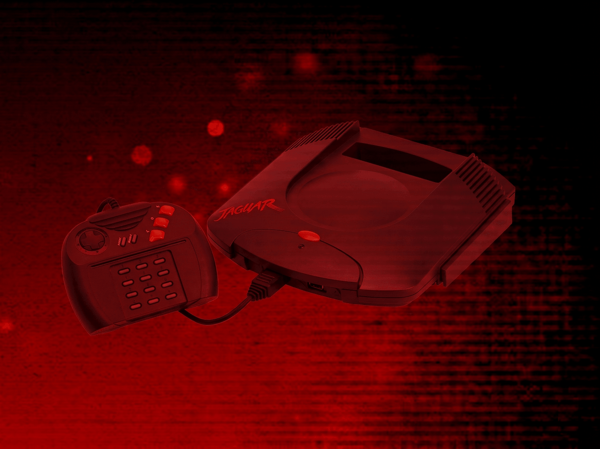
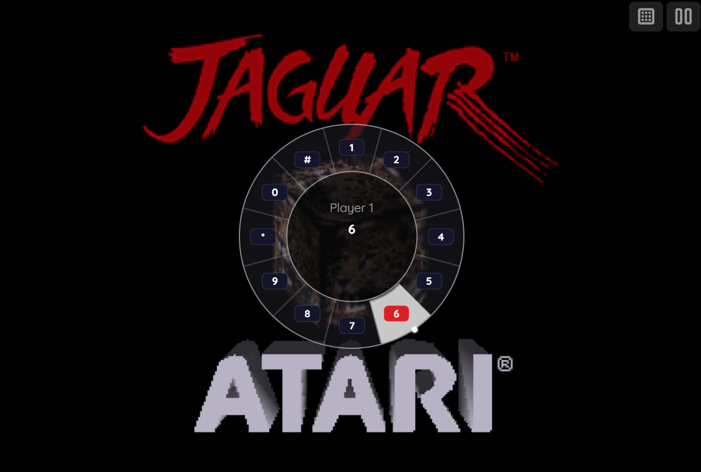
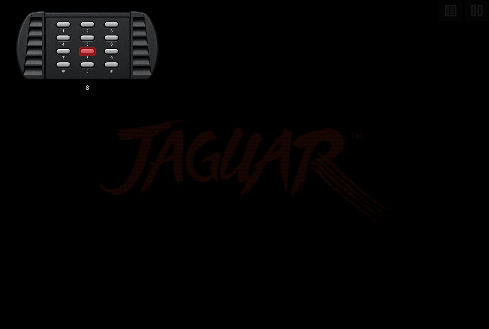
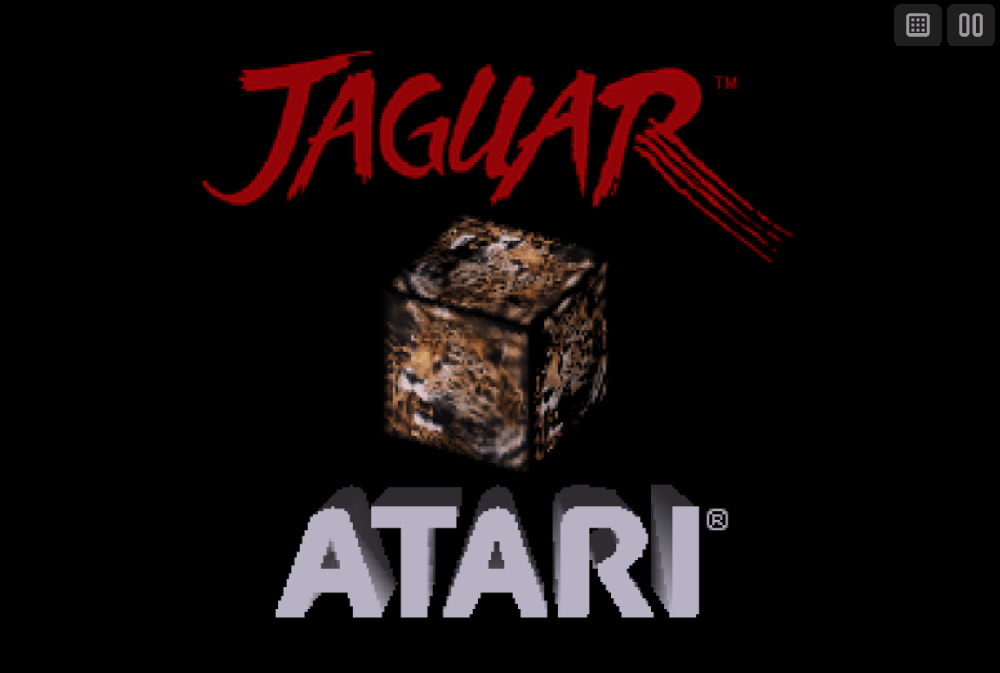
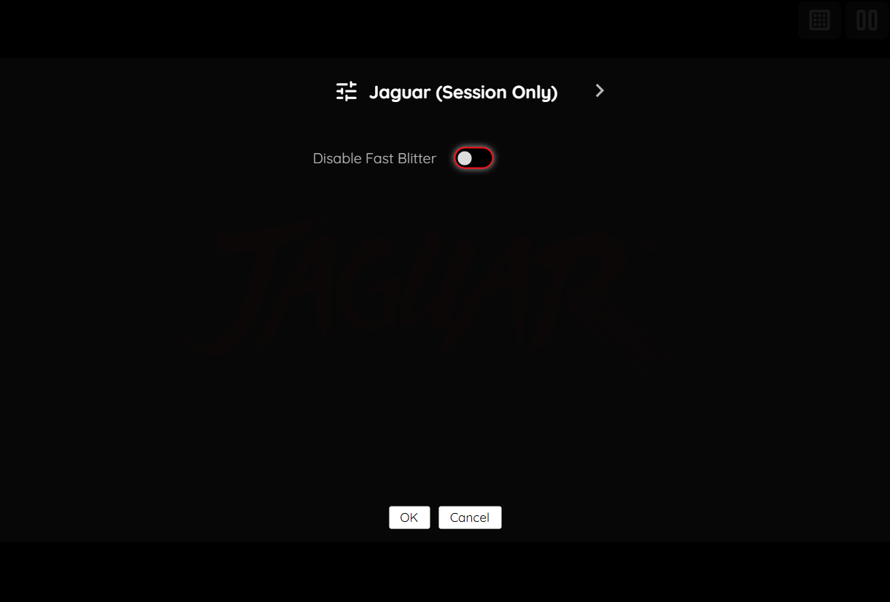

# Atari Jaguar (Experimental)

!!! warning
    The Atari Jaguar application is currently designated as an *experimental* application.
    <p>
    This designation has been applied due to the following:
    </p>
    <ul>
    <li>The underlying emulator has known compatibility issues across the Jaguar game library.</li>
    </ul>
    <p>
    Applications marked as *experimental* are flagged with an "Experimental" tag in the feed editor's [Select Application Dialog](../../../editor/dialogs/item-dialog.md#select-application-dialog), but are otherwise fully available for use in both the editor and the webЯcade player. There is no separate setting required to enable them.
    </p>

## Overview

The Atari Jaguar application is an emulator for the [Atari Jaguar](https://en.wikipedia.org/wiki/Atari_Jaguar) game console, a 64-bit cartridge-based console released by Atari in 1993.

<figure>
  
</figure>

## Controls

The emulator supports up to two controllers. The keyboard and gamepad mappings are listed in the tables below.

### Keyboard

Keyboard support, including the direct numeric keypad passthrough, is only available for controller one.

| __Name__ | <div style="min-width:140px">__Keys__</div> | __Comments__ |
|--------------------------|---------------------------------------------| |
| Move | {: class="control"} {: class="control"} {: class="control"} {: class="control"} | |
| Option | {: class="control"} | |
| Pause | {: class="control"} | The __Right Shift Key__. Displays the webЯcade pause screen. |
| Fire C | {: class="control"} | Default mapping. Can be changed via the *Mappings* tab in the editor. |
| Fire B | {: class="control"} | Default mapping. |
| Fire A | {: class="control"} | Default mapping. |
| Keypad "8" | {: class="control"} | Default mapping. |
| Keypad "7" | {: class="control"} | Default mapping. |
| Keypad "9" | {: class="control"} | Default mapping. |
| Keypad "4" | {: class="control"} | Default mapping. |
| Keypad "6" | {: class="control"} | Default mapping. |
| Keypad 1-9, 0 | {: class="control"} - {: class="control"} | Direct keypad passthrough. Presses the keypad key regardless of the [Keypad](#keypad) screen being open. |
| Keypad * | {: class="control"} | |
| Keypad # | {: class="control"} | |
| Show Keypad | {: class="control"} | The __Left Control Key__. Hold, then release, to open the on-screen [Keypad](#keypad) screen. |
| Show Pause Screen | {: class="control"} | |
| Show Pause Screen<br>(Alternate) | {: class="control"} + {: class="control"} | Hold the __Left Control Key__, then press the __Right Shift Key__ before releasing Control, to show the webЯcade pause screen instead of the [Keypad](#keypad). |

### Gamepad

Gamepad support is available for both controllers.

| __Name__ | <div style="min-width:140px">__Gamepad__</div> | __Comments__ |
| --- | --- | --- |
| Move | {: class="control"} &nbsp;or&nbsp; {: class="control"} | |
| Option | {: class="control"} | Not available for Xbox and not recommended for iOS (see alternate)<br><br>Press the __Menu (Start) Button__. |
| Option<br>(Alternate) | {: class="control"} &nbsp;and&nbsp; {: class="control"} | Hold down the __Right Trigger__ and click (press down) on the __Right Thumbstick__. |
| Pause (Jaguar) | {: class="control"} | Not available for Xbox and not recommended for iOS (see alternate)<br><br>Press the __View (Back) Button__. Sends the real Jaguar Pause button press to the game (the same signal the real Jaguar controller's Pause button sends) — this is not the webЯcade pause screen, and what happens depends on the game. |
| Pause (Jaguar)<br>(Alternate) | {: class="control"} &nbsp;and&nbsp; {: class="control"} | Hold down the __Right Trigger__ and click (press down) on the __Left Thumbstick__. |
| Fire C | {: class="control"} | Default mapping. Can be changed via the *Mappings* tab in the editor. |
| Fire B | {: class="control"} | Default mapping. |
| Fire A | {: class="control"} | Default mapping. |
| Keypad "8" | {: class="control"} | Default mapping. |
| Keypad "7" | {: class="control"} | Default mapping. |
| Keypad "9" | {: class="control"} | Default mapping. |
| Keypad "4" | {: class="control"} | Default mapping. Suppressed while held down for the __Show (Grid) Keypad__ combo below. |
| Keypad "6" | {: class="control"} | Default mapping. |
| Radial Keypad | {: class="control"} | Move the __Right Thumbstick__ in a direction to quick-select a key. See [Keypad](#keypad). |
| Show (Grid) Keypad | {: class="control"} &nbsp;and&nbsp; {: class="control"} | Hold down the __Left Trigger__ and click (press down) on the __Right Thumbstick__. See [Keypad](#keypad). |
| Show Pause Screen | {: class="control"} &nbsp;and&nbsp; {: class="control"} | Not available for Xbox.<br><br>Hold down the __X Button__ and press the __View (Back) Button__. Displays the webЯcade pause screen. |
| Show Pause Screen<br>(Alternate) | {: class="control"} &nbsp;and&nbsp; {: class="control"} | Hold down the __Left Trigger__ and click (press down) on the __Left Thumbstick__. Displays the webЯcade pause screen. |

## Keypad

The real Jaguar controller includes a 16-key numeric keypad (`0`-`9`, `*`, `#`) used by many games for menus, codes, and secondary actions. webЯcade provides two different ways to interact with it:

### Radial Keypad (quick-select)

<figure>
  
  <figcaption>Radial Keypad</figcaption>
</figure>

Moving the right analog stick in a direction brings up a 12-key radial (pie-menu) selector, arranged clockwise from 12 o'clock: `1, 2, 3` (top), `4, 5, 6` (right), `7, 8, 9` (bottom), `*, 0, #` (left). Point the stick toward a key and confirm with either the Left or Right Bumper to press it. Releasing the stick back to center dismisses the selector without pressing anything.

| __Name__ | <div style="min-width:140px">__Gamepad__</div> | __Comments__ |
| --- | --- | --- |
| Show Radial Keypad / Choose Key | {: class="control"} | Suppressed while the Left Trigger is held down (to avoid conflicting with the grid Keypad combo below). |
| Press Key | {: class="control"} &nbsp;or&nbsp; {: class="control"} | |

### Grid Keypad

<figure>
  
  <figcaption>Grid Keypad</figcaption>
</figure>

| __Name__ | <div style="min-width:140px">__Gamepad__</div> | __Comments__ |
| --- | --- | --- |
| Show Grid Keypad | {: class="control"} &nbsp;and&nbsp; {: class="control"} | Hold down the __Left Trigger__ and click (press down) on the __Right Thumbstick__. |
| Choose Key | {: class="control"} &nbsp;or&nbsp; {: class="control"} | |
| Press Key | {: class="control"} | |

| __Name__ | <div style="min-width:140px">__Keys__</div> | __Comments__ |
|--------------------------|---------------------------------------------| |
| Show Grid Keypad | {: class="control"} | Hold, then release, the __Left Control Key__. |
| Close Keypad | {: class="control"} | |

## On-screen Controls

<figure>
  
  <figcaption>On-screen Controls</figcaption>
</figure>

The Jaguar application includes a set of on-screen controls which are detailed below.

| __Button__ |  | __Description__ |
| --- | --- | --- |
| Keypad |  | Opens the [Grid Keypad](#grid-keypad) screen. |
| Pause (Show Pause Screen) |  | Displays the webЯcade pause screen. |

Whether these buttons are always displayed, or only displayed once touch, mouse, or keyboard input is detected, can be configured via the "On-screen controls" field on the [Display Settings](#display-settings-tab) tab.

## Pause Screen

The Jaguar application's pause screen provides access to application settings.

<figure>
  
  <figcaption>Pause Screen</figcaption>
</figure>

### Jaguar Settings Tab (Session Only)

| __Field__ | __Description__ |
| --- | --- |
| Disable Fast Blitter | The Fast Blitter trades rendering accuracy for speed and is used by default. Enable this to fall back to the slower, more accurate blitter instead, for games with visual glitches. |

### Display Settings Tab

| __Field__ | __Description__ |
| --- | --- |
| Screen size | The screen size to use when playing a game.<br><br>Options include:<br><ul><li>`Native` : The application's native resolution</li><li>`16:9` : Widescreen resolution</li><li>`Fill` : Fill the entire contents of the screen</li></ul> |
| Bilinear filter | The type of bilinear filter to apply to the output display. |
| On-screen controls | Toggle whether the on-screen controls should always be displayed, or only displayed once touch, mouse, or keyboard input has been detected. |

## Feed

This section details how Atari Jaguar application instances can be added to feeds.

### Type

The type name for the Atari Jaguar application is `retro-virtual-jaguar`.

| __Type__ | __Cheats__ | __Shaders__ | __Retro<br>Achievements__ | __Low<br>CPU__ |
| --- | --- | --- | --- | --- |
| `retro-virtual-jaguar` ⭐ | ✅ | ✅ | ✅ | x |

!!! note
    The alias `jaguar` also currently maps to this application. In the future, the `jaguar` alias may be mapped
    to another Atari Jaguar application (different emulator implementation) if it is determined to be a
    more appropriate default.

### Item Properties

The table below contains the properties that are specific to the Atari Jaguar application. These properties are specified in the `props` object of a feed item.

| __Property__ | __Type__ | __Required__ | __Details__ |
|----------|------|----------|---------|
| rom | URL | Yes | URL to an Atari Jaguar ROM file (`.j64` or `.jag`) or a zip file containing one. |
| cheat | URL | No | URL to a cheat file for the current ROM. See the [Cheats Tab](../../../editor/dialogs/item-dialog.md#cheats-tab) in the Item Editor for details on assigning cheat files. |
| zoomLevel | Numeric | No | A numeric value indicating how much the display image should be zoomed in (0-40). |
| disableFastBlitter | Boolean | No | Whether to disable the Fast Blitter (trading speed for rendering accuracy). Defaults to `false`. Can also be toggled per-session via the [Jaguar Settings](#jaguar-settings-tab-session-only) tab. |
| useRealBios | Boolean | No | How the cartridge boots. `false` (default) has the emulator emulate the boot sequence itself (faster boot, skips the boot animation). `true` runs the actual Jaguar boot ROM, which some titles require. The boot ROM is built into the emulator either way, so no file is needed for either setting. |
| mappings | Map of Strings (key-value pairs) | No | <p>Game-specific mappings of the gamepad's mappable buttons to a Jaguar fire button or keypad key. See [Controls](#controls) and [Keypad](#keypad) for the default mapping.</p><p>The simplest way to set these mappings is to use the *Mappings* tab in the [Feed Editor](../../../editor/index.md) for the item (game).</p><p>The following is a simple example of a set of mappings. The `key` is the gamepad controller button (`a`, `b`, `x`, `y`, `lb`, `rb`, `lt`, `rt`) and the `value` is the Jaguar fire button (`firea`, `fireb`, `firec`) or keypad key label (`0`-`9`, `*`, `#`) that it is mapped to.</p><p>``{``<br>&nbsp;&nbsp;&nbsp;&nbsp;``"x": "firec",``<br>&nbsp;&nbsp;&nbsp;&nbsp;``"a": "fireb",``<br>&nbsp;&nbsp;&nbsp;&nbsp;``"b": "firea",``<br>&nbsp;&nbsp;&nbsp;&nbsp;``"y": "8"``<br>``}``</p> |
| descriptions | Map of Strings (key-value pairs) | No | <p>Custom display names for Jaguar keypad keys and fire buttons, shown in the on-screen keypad display and controls screen.</p><p>The `key` is a keypad key or fire-button label (matching the `value` of a `mappings` entry: `firea`, `fireb`, `firec`, or `0`-`9`/`*`/`#`) and the `value` is the custom name to display.</p><p>``{``<br>&nbsp;&nbsp;&nbsp;&nbsp;``"firec": "Jump",``<br>&nbsp;&nbsp;&nbsp;&nbsp;``"7": "Reload"``<br>``}``</p> |

### Example

The following is an example of a complete feed that consists of a single Atari Jaguar application instance (`type` value of `jaguar`).

``` json hl_lines="9 11"
{
  "title": "Atari Jaguar",
  "categories": [
    {
      "title": "Atari Jaguar Games",
      "items": [
        {
          "title": "My Jaguar Game",
          "type": "jaguar",
          "props": {
            "rom": "https://<host>/mygame.j64"
          }
        }
      ]
    }
  ]
}
```

## References

- [Atari Jaguar Application GitHub Repository](https://github.com/webrcade/webrcade-app-retro-virtual-jaguar)
