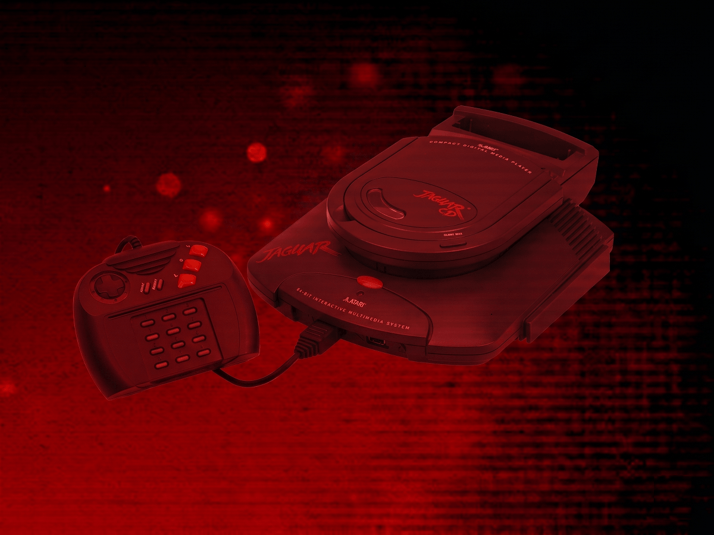

# Atari Jaguar CD (Experimental)

!!! warning
    The Atari Jaguar CD application is currently designated as an *experimental* application.
    <p>
    This designation has been applied due to the following:
    </p>
    <ul>
    <li>The underlying emulator has known compatibility issues across the Jaguar CD game library.</li>
    </ul>
    <p>
    Applications marked as *experimental* are flagged with an "Experimental" tag in the feed editor's [Select Application Dialog](../../../editor/dialogs/item-dialog.md#select-application-dialog), but are otherwise fully available for use in both the editor and the webЯcade player. There is no separate setting required to enable them.
    </p>

## Overview

The Atari Jaguar CD application is an emulator for the [Atari Jaguar CD](https://en.wikipedia.org/wiki/Atari_Jaguar_CD), a CD-ROM add-on for the Atari Jaguar released in 1995.

<figure>
  
</figure>

## Adding Games (Feed Editor)

!!! important
    The Jaguar CD application only supports the `.CDI` disc image format.

To add a Jaguar CD game in the [Feed Editor](../../../editor/index.md): if your content is on your computer, see [Adding Items: Local Files](../../../editor/workspace/addingitems-local.md); if it's already hosted online, see [Adding Items: From URLs (Manual)](../../../editor/workspace/addingitems-url.md#manual-item-creation).

!!! important
    Both the iOS Safari and Xbox Series X|S Edge browsers limit the amount of memory that can be consumed by a particular web application (such as webЯcade).
    <p>
    The current limit is around 450 megabytes. Therefore, loading larger disc sizes may fail.
    </p>
    <p>
    To increase the likelihood of a game with a larger disc size loading, you can optionally choose to launch the game using a standalone-based link (versus launching the game within the webЯcade player or editor). See the [Standalone](../../../standalone/index.md) section of this documentation for further information (On Xbox, you would most likely want to bookmark the direct link. On iOS, you would most likely want to add the game to the home screen).
    </p>

## Controls

The Jaguar CD application shares the exact same controller, keypad, and on-screen controls behavior as the [Atari Jaguar](../jaguar/index.md) application. See the following sections on that page for full details:

- [Controls](../jaguar/index.md#controls) (Keyboard and Gamepad)
- [Keypad](../jaguar/index.md#keypad) (Radial Keypad and Grid Keypad)
- [On-screen Controls](../jaguar/index.md#on-screen-controls)
- [Pause Screen settings](../jaguar/index.md#pause-screen)

Game-specific button mappings for the Jaguar CD application are matched by game title rather than by ROM hash (since there is no cartridge ROM to hash).

## Saves

The Jaguar CD application supports preserving in-game save data between sessions. This state is persisted in the browser's local storage or optionally to [cloud-based storage](../../../storage/index.md). State information will be persisted whenever the pause screen is displayed (or the game is exited). Therefore, the pause screen should be displayed periodically to ensure the state is properly persisted.

## Feed

This section details how Atari Jaguar CD application instances can be added to feeds.

### Type

The type name for the Atari Jaguar CD application is `retro-virtual-jaguar-cd`.

| __Type__ | __Cheats__ | __Shaders__ | __Retro<br>Achievements__ | __Low<br>CPU__ |
| --- | --- | --- | --- | --- |
| `retro-virtual-jaguar-cd` ⭐ | ✅ | ✅ | ✅ | x |

!!! note
    The alias `jaguarcd` also currently maps to this application. In the future, the `jaguarcd` alias may be mapped
    to another Atari Jaguar CD application (different emulator implementation) if it is determined to be a
    more appropriate default.

### Item Properties

The table below contains the properties that are specific to the Atari Jaguar CD application. These properties are specified in the `props` object of a feed item.

| __Property__ | __Type__ | __Required__ | __Details__ |
|----------|------|----------|---------|
| uid | String | Yes | <p>A unique identifier for the particular game (must be unique across all Jaguar CD games).</p><p>This identifier is primarily used to associate persistent state with the game.</p> |
| discs | Array of URLs | Yes | <p>Array of URLs to one or more (for multi-disc games) Jaguar CD game discs.</p><p>The Jaguar CD application only supports the `.CDI` disc image format.</p> |
| cheat | URL | No | URL to a cheat file for the current ROM. See the [Cheats Tab](../../../editor/dialogs/item-dialog.md#cheats-tab) in the Item Editor for details on assigning cheat files. |
| zoomLevel | Numeric | No | A numeric value indicating how much the display image should be zoomed in (0-40). |
| disableFastBlitter | Boolean | No | Whether to disable the Fast Blitter (trading speed for rendering accuracy). Defaults to `false`. Can also be toggled per-session via the [Jaguar Settings](../jaguar/index.md#jaguar-settings-tab-session-only) tab. |
| useRealBios | Boolean | No | How the disc boots. `false` (default) has the emulator emulate the boot sequence itself (faster boot, skips the boot animation). `true` runs the actual Jaguar/Jaguar CD boot ROMs, which some titles require. The boot ROMs are built into the emulator either way, so no file is needed for either setting. |
| mappings | Map of Strings (key-value pairs) | No | Game-specific mappings of the gamepad's mappable buttons to a Jaguar fire button or keypad key. See the [Atari Jaguar Controls](../jaguar/index.md#controls) and [Keypad](../jaguar/index.md#keypad) sections for the default mapping and valid keys/values. |
| descriptions | Map of Strings (key-value pairs) | No | Custom display names for Jaguar keypad keys and fire buttons. See the [Atari Jaguar Item Properties](../jaguar/index.md#item-properties) section for valid keys/values. |

### Example

The following is an example of a complete feed that consists of a single Atari Jaguar CD application instance (`type` value of `jaguarcd`).

``` json hl_lines="9 11-14"
{
  "title": "Atari Jaguar CD",
  "categories": [
    {
      "title": "Atari Jaguar CD Games",
      "items": [
        {
          "title": "My Jaguar CD Game",
          "type": "jaguarcd",
          "props": {
            "uid": "a1b2c3d4-e5f6-7890-abcd-ef1234567890",
            "discs": [
                "https://<host>/mygame.cdi"
            ]
          }
        }
      ]
    }
  ]
}
```

## References

- [Atari Jaguar CD Application GitHub Repository](https://github.com/webrcade/webrcade-app-retro-virtual-jaguar)
