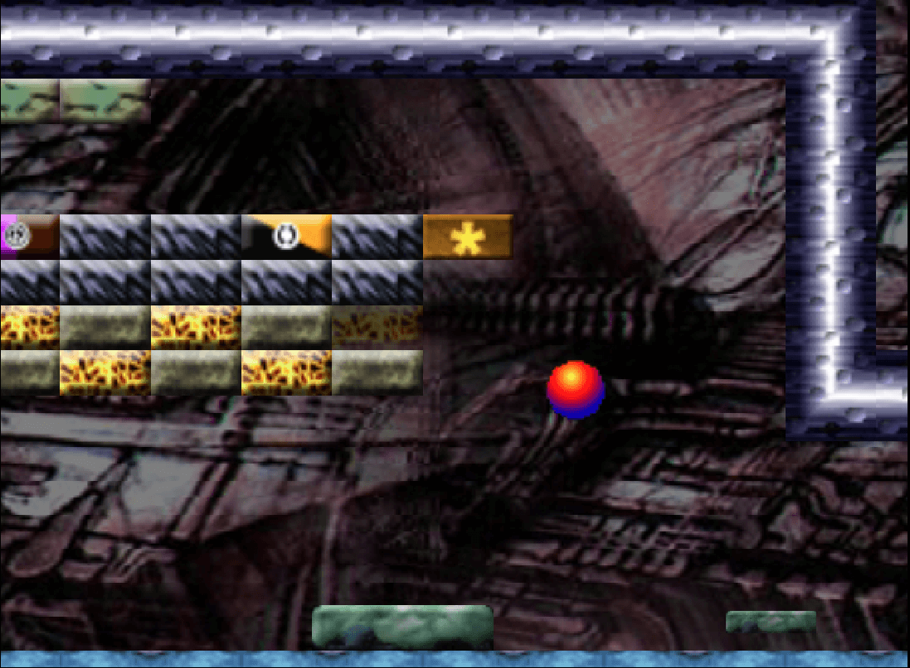
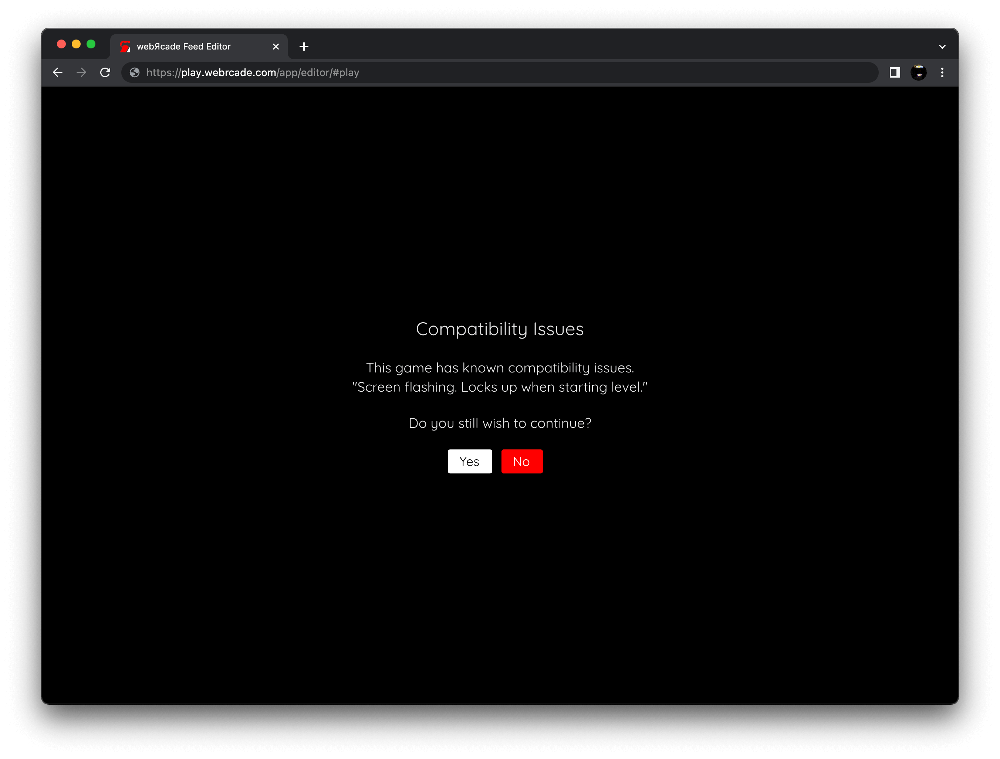
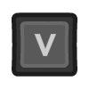

# Nintendo 64

!!! warning
    The resource requirements to properly run this emulator are high.

## Overview

The Nintendo 64 (N64) application is an emulator for the [Nintendo 64 game console](https://en.wikipedia.org/wiki/Nintendo_64).

<figure>
  
  <figcaption>Dexanoid R1 by Protest Design</figcaption>
</figure>

Due to its high resource requirements (see *warning* at top of this page), the following devices are minimally recommended for running this application:

* Modern PC or Mac
* iPhone 11 or iPad 9th Generation (or newer)
* Xbox Series X|S gaming consoles

Android-based devices are not currently recommended due to poor performance with this application.

## Game Compatibility

A small number of N64 games are known to have compatibility issues or defects with the default N64 application type.

{: class="center zoomD"}

If a game is known to have an issue, a screen similar to the one shown above will be displayed. If this screen is displayed, selecting "No" (not continuing) is highly recommended.

## Controls

The emulator supports up to four controllers. The keyboard and gamepad mappings are listed in the tables below.

### Keyboard

Keyboard support is only available for controller one.

| __Name__ | <div style="min-width:140px">__Keys__</div> | __Comments__ |
|--------------------------|---------------------------------------------| |
| Analog Stick | {: class="control"} {: class="control"} {: class="control"} {: class="control"}  | |
| Analog -25% | {: class="control"} | Reduces analog input by 25%.<br> Can be combined with __Control Key__ to reduce by 75%.<br><br>Useful in situations where the analog stick needs to be gently moved. |
| Analog -50% | {: class="control"} | Reduces analog input by 50%.<br>Can be combined with __Shift Key__ to reduce by 75%.<br><br>Useful in situations where the analog stick needs to be gently moved. |
| A | {: class="control"} | |
| B | {: class="control"} | |
| L | {: class="control"} | |
| R | {: class="control"} | |
| Z | {: class="control"} | |
| D-pad | {: class="control"} {: class="control"} {: class="control"} {: class="control"}  | |
| C Buttons | {: class="control"} {: class="control"} {: class="control"} {: class="control"}  | |
| Start | {: class="control"} | |
| Show Pause Screen | {: class="control"} | |

### Gamepad

Gamepad support is available for all controllers.

| __Name__ | <div style="min-width:140px">__Gamepad__</div> | __Comments__ |
| --- | --- | --- |
| D-pad                        |  {: class="control"} | |
| Analog Stick                         |  {: class="control"} | |
| A                       | {: class="control"} | |
| B                       | {: class="control"}  | |
| L                       | {: class="control"} | |
| R                       | {: class="control"}  | |
| Z                       | {: class="control"} &nbsp;or&nbsp; {: class="control"} | |
| C Buttons (up/down/left/right)  | {: class="control"} | |
| Start                        | {: class="control"} | Not available for Xbox and not recommended for iOS (see alternate)<br><br>Press the __Menu (Start) Button__. |
| Start<br>(Alternate)            | {: class="control"} &nbsp;and&nbsp; {: class="control"} | Hold down the __Right Trigger__ and click (press down) on the __Right Thumbstick__. |
| Show Pause Screen                    | {: class="control"} &nbsp;and&nbsp; {: class="control"} | Not available for Xbox.<br><br>Hold down the __X Button__ and press the __View (Back) Button__. |
| Show Pause Screen<br>(Alternate)        | {: class="control"} &nbsp;and&nbsp; {: class="control"} | Hold down the __Left Trigger__ and click (press down) on the __Left Thumbstick__. |

## Pause Screen

The N64 application's pause screen provides access to application settings.

### Display Settings Tab

| __Field__ | __Description__ |
| --- | --- |
| Screen size | The screen size to use when playing a game.<br><br>Options include:<br><ul><li>`Native` : The application's native resolution</li><li>`16:9` : Widescreen resolution</li><li>`Fill` : Fill the entire contents of the screen</li></ul> |
| Bilinear filter | The type of bilinear filter to apply to the output display. |
| On-screen controls | Toggle whether the on-screen controls should always be displayed, or only displayed once touch, mouse, or keyboard input has been detected. |

## SRAM, EEPROM, Flash, and Controller Pak Storage

The N64 application supports preserving state from game cartridge-specific chips (SRAM, EEPROMs, Flash) and Controller Paks between sessions. This state is persisted in the browser's local storage or optionally to [cloud-based storage](../../../storage/index.md). State information will be persisted whenever the pause screen is displayed (or the game is exited). Therefore, the pause screen should be displayed periodically to ensure the state is properly persisted.

## Feed

This section details how N64 application instances can be added to feeds.

### Types

Two N64 application types are available, each offering different trade-offs in compatibility, features, and system resource requirements. The type below marked with a ⭐ is the default, and is mapped to the `n64` alias. The default can be overridden globally in [Settings](../../../userguide/settings.md) > *Applications*, or on a per-item basis in the [Feed Editor](../../../editor/index.md).

| __Type__ | __Cheats__ | __Shaders__ | __Retro<br>Achievements__ | __Low<br>CPU__ |
| --- | --- | --- | --- | --- |
| `retro-mupen64plus-next` ⭐ | ✅ | ✅ | ✅ | x |
| `parallel-n64` | x | x | ✅ | x |

!!! note
    The `parallel-n64` type is older and generally less compatible than the current default. It additionally exposes a "Vertex buffers" option, on its own N64 Settings tab. Disabling this option can improve performance on certain platforms/devices, including Apple M1-based Macs.

### Properties

The table below contains the properties that are specific to the N64 application. These properties are
specified in the `props` object of a feed item.

| __Property__ | __Type__ | __Required__ | __Details__ |
|----------|------|----------|---------|
| rom | URL | Yes | URL to an N64 ROM file or a zip file containing a ROM file. |
| cheat | URL | No | URL to a cheat file for the current ROM. See the [Cheats Tab](../../../editor/dialogs/item-dialog.md#cheats-tab) in the Item Editor for details on assigning cheat files.<br><br>*(`retro-mupen64plus-next` type only)* |
| zoomLevel | Numeric | No | A numeric value indicating how much the display image should be zoomed in (0-40).<br><br>This property is typically used to hide the black borders that are present on some N64 games. |

### Example

The following is an example of a complete feed that consists of a single N64 application instance (`type` value of `n64`).
``` json hl_lines="11 13"
{
  "title": "N64 Feed",
  "longTitle": "Nintendo 64 Example Feed",
  "categories": [
    {
      "title": "N64 Games",
      "longTitle": "Nintendo 64 Games",
      "items": [
        {
          "title": "Dexanoid R1",
          "type": "n64",
          "props": {
            "rom": "https://dl.dropboxusercontent.com/s/ueukhxqno0jowm6/dexanoid.zip"
          }
        }
      ]
    }
  ]
}
```

## References

- [Nintendo 64 Application GitHub Repository (`retro-mupen64plus-next`)](https://github.com/webrcade/webrcade-app-retro-mupen64plus-next)
- [Nintendo 64 Application GitHub Repository (`parallel-n64`)](https://github.com/webrcade/webrcade-app-parallel-n64)
